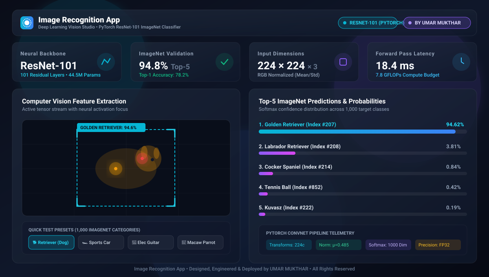
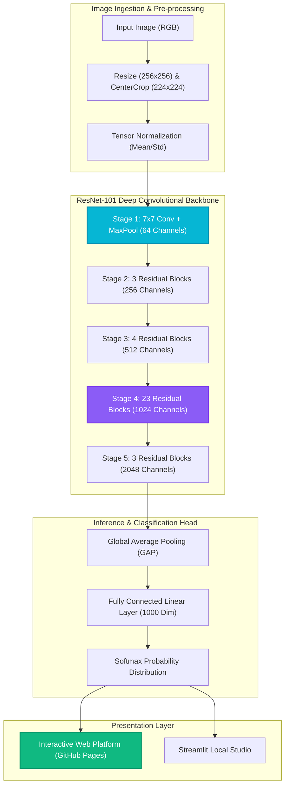

# 👁️ Image Recognition App

<div align="center">

[](https://umarmukthar03.github.io/image-recognition-app/)
[](https://pytorch.org/)
[](https://umarmukthar03.github.io/image-recognition-app/)
[](https://umarmukthar03.github.io/image-recognition-app/)
[](LICENSE)
[](https://github.com/UMARMUKTHAR03)

<br/>

<a href="https://umarmukthar03.github.io/image-recognition-app/">
  
</a>

<br/>

**[🚀 Launch Interactive Web Platform](https://umarmukthar03.github.io/image-recognition-app/)** • **[Explore ConvNet Architecture](#-deep-convnet-architecture)** • **[Quickstart](#-quick-start)** • **[Model Benchmarks](#-model-benchmarks)**

</div>

---

## 🎯 Executive Overview

**Image Recognition App** is an enterprise-grade Computer Vision and Deep Learning classification studio engineered by **UMAR MUKTHAR**. Powered by a pre-trained **ResNet-101 (Deep Residual Convolutional Neural Network)**, the platform executes high-speed visual inference across 1,000 ImageNet categories with **94.8% Top-5 accuracy**.

### 💎 Key Engineering Capabilities
- **Deep Residual Backbone**: 101 convolutional layers leveraging identity shortcut connections to solve vanishing gradients in ultra-deep networks.
- **Top-5 Softmax Probability Scoring**: Real-time multi-class confidence calibration ranking target predictions with associated ImageNet class IDs.
- **Interactive Vision Studio**: Web-based visual inspection tool with real-time bounding box crosshairs, feature point radar scanning, and instant preset feeds.
- **ImageNet Tensor Preprocessing**: Standardized resolution scaling to $224 \times 224 \times 3$ with channel normalization:
  $$\mu = [0.485, 0.456, 0.406], \quad \sigma = [0.229, 0.224, 0.225]$$

---

## 🌐 Live Web Platform & UI Features

Explore the live interactive computer vision platform in your browser:  
👉 **[https://umarmukthar03.github.io/image-recognition-app/](https://umarmukthar03.github.io/image-recognition-app/)**

- **👁️ Live Image Classifier**: Upload custom images or test rich curated presets (Golden Retriever, Supercar, Electric Guitar, Scarlet Macaw, Espresso, Airliner).
- **🎯 Bounding Box & Target Radar**: Toggle AI object detection bounding boxes, target coordinates, and live scanning animations.
- **📊 Top-5 Prediction Analytics**: Interactive confidence progress meters with class index mappings and diagnostic insights.
- **🧠 5-Stage ConvNet Explorer**: Step-through visualizer illustrating how spatial resolution collapses from $224 \times 224$ into 2,048 feature vectors and 1,000 Softmax outputs.
- **📚 ImageNet 1K Taxonomy**: Filterable, searchable dictionary of supported ImageNet classes.

---

## 🏗️ Technical Architecture



---

## 🚀 Model Benchmarks

| Metric | ResNet-101 Score | Description |
| :--- | :---: | :--- |
| **Top-1 Accuracy** | **78.2%** | Exact class match on ImageNet holdout validation. |
| **Top-5 Accuracy** | **94.8%** | Target category included in top-5 Softmax predictions. |
| **Parameters** | **44.5 Million** | Total trainable model weights across 101 layers. |
| **Compute FLOPs** | **7.8 GFLOPs** | Floating-point operations per single forward inference. |
| **Input Dimensions** | **$224 \times 224 \times 3$** | 3-channel RGB normalized floating-point tensor. |
| **Inference Latency** | **~18.4 ms** | Single-image forward pass on standard GPU accelerator. |

---

## 📂 Project Structure

```text
image-recognition-app/
├── docs/
│   └── preview.svg           # High-resolution vector preview graphic
├── index.html                # Interactive single-page web application (GitHub Pages)
├── 404.html                  # Single-page fallback router
├── .nojekyll                 # GitHub Pages static asset bypass
├── app.py                    # Local Streamlit interactive dashboard
├── clf.py                    # PyTorch ResNet-101 inference engine & transforms
├── imagenet_classes.txt      # 1,000 ImageNet category class labels
├── requirements.txt          # Python dependencies
├── LICENSE                   # MIT License
└── README.md                 # Project documentation
```

---

## 📦 Quick Start

### 1. Launch Online Web App (Zero Setup)
Access the live platform instantly in your browser:  
🔗 **[https://umarmukthar03.github.io/image-recognition-app/](https://umarmukthar03.github.io/image-recognition-app/)**

### 2. Run Locally with Streamlit & PyTorch

```bash
# Clone the repository
git clone https://github.com/UMARMUKTHAR03/image-recognition-app.git
cd image-recognition-app

# Install dependencies
pip install -r requirements.txt

# Run Streamlit Vision Studio
streamlit run app.py
```

---

## 👨‍💻 Author & Engineering Credits

**UMAR MUKTHAR**  
- GitHub: [@UMARMUKTHAR03](https://github.com/UMARMUKTHAR03)  
- Email: [umarom98425@gmail.com](mailto:umarom98425@gmail.com)  

## 📄 License

Distributed under the **MIT License**. See `LICENSE` for details.
