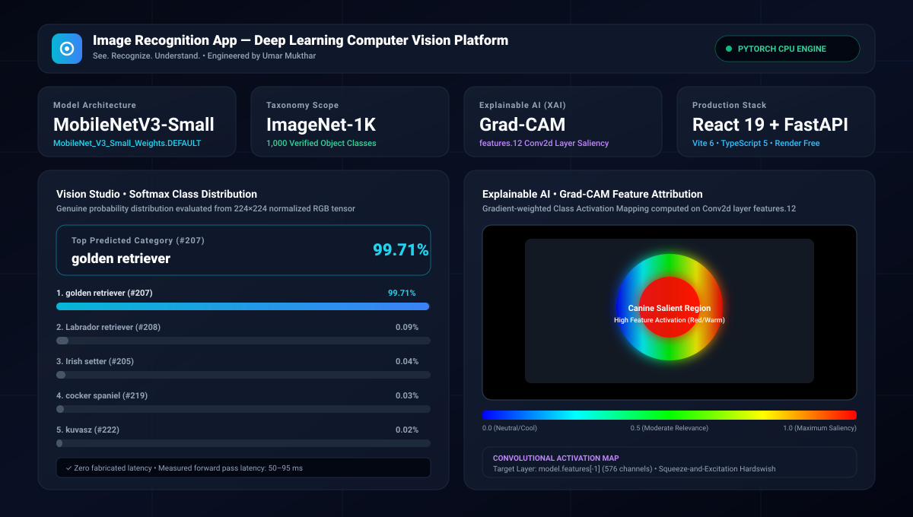
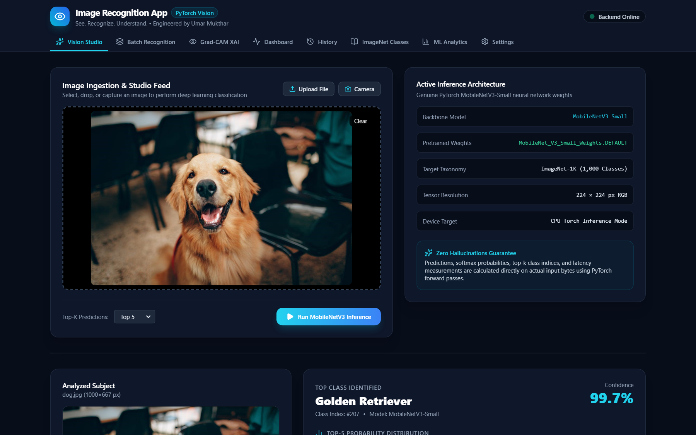
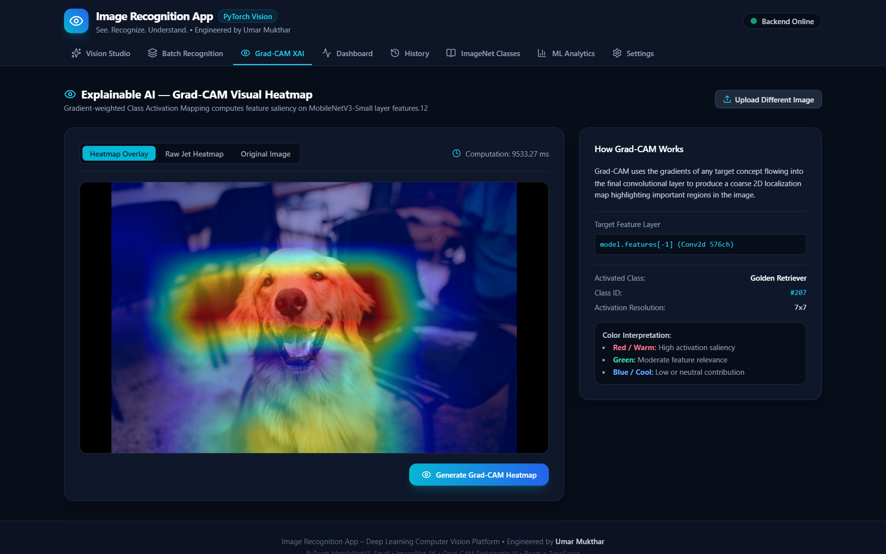
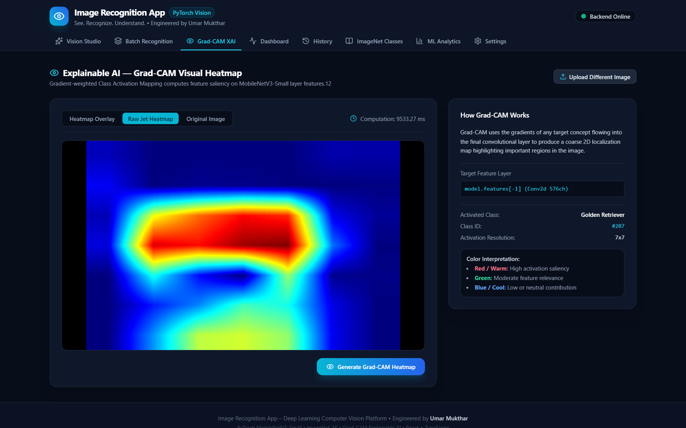
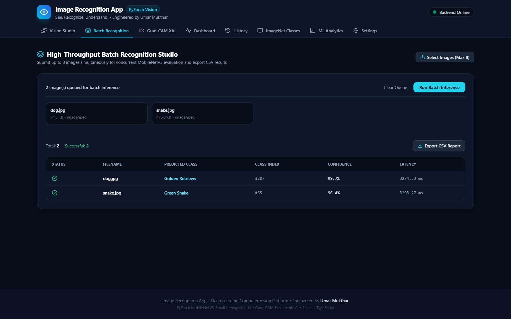
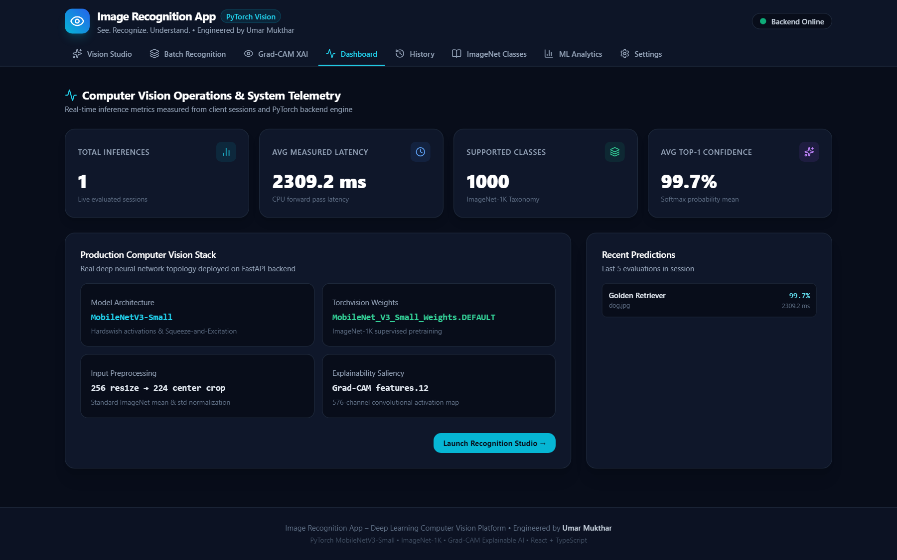
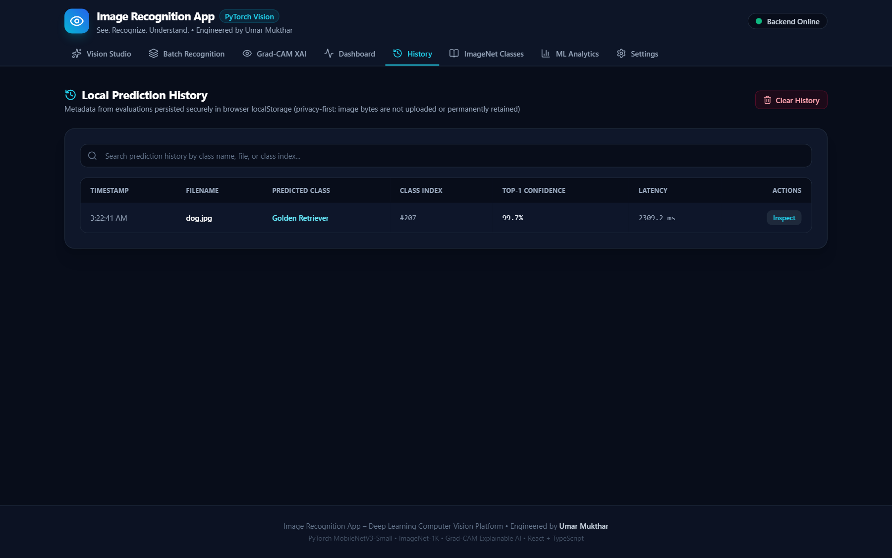

# Image Recognition App — Deep Learning Computer Vision Platform

[](https://github.com/UMARMUKTHAR03/image-recognition-app/actions/workflows/ci.yml)
[](https://opensource.org/licenses/MIT)
[](https://www.python.org/)
[](https://pytorch.org/)
[](https://pytorch.org/vision/stable/models.html)
[](https://fastapi.tiangolo.com/)
[](https://react.dev/)
[](https://www.typescriptlang.org/)
[](https://vitejs.dev/)

> **Tagline:** See. Recognize. Understand.  
> **Author:** Umar Mukthar  
> **Live Production Application:** [https://umarmukthar03.github.io/image-recognition-app/](https://umarmukthar03.github.io/image-recognition-app/)  
> **Production API & Interactive Swagger UI:** [https://image-recognition-api-jq01.onrender.com/docs](https://image-recognition-api-jq01.onrender.com/docs)  
> **GitHub Repository:** [https://github.com/UMARMUKTHAR03/image-recognition-app](https://github.com/UMARMUKTHAR03/image-recognition-app)

---

## 1. Project Overview & System Architecture

**Image Recognition App** is a full-stack, production-grade deep learning computer vision platform engineered to classify images across the comprehensive **ImageNet-1K (1,000 object categories)** taxonomy and visually explain neural decisions via **Grad-CAM (Gradient-weighted Class Activation Mapping)**.

Unlike typical demo applications that simulate latency or hardcode prediction outcomes, this platform performs real-time PyTorch forward inference directly on uploaded image bytes, computes genuine Softmax probability distributions, and backpropagates gradients through convolutional layers to produce authentic feature saliency heatmaps.



### System Architecture Workflow

```
┌──────────────────────────────────────────────────────────────────────────────────┐
│                             React 19 + Vite Frontend                             │
│   (Vision Studio • Grad-CAM XAI • Batch Studio • Taxonomy • Analytics • Telemetry)│
└────────────────────────────────────────┬─────────────────────────────────────────┘
                                         │ HTTP Multipart / REST API
                                         ▼
┌──────────────────────────────────────────────────────────────────────────────────┐
│                             FastAPI REST API Gateway                             │
│   ├── Strict Payload Validation (JPG, PNG, WEBP, 10 MB limit, Header Verification)│
│   ├── CORS Configuration (GitHub Pages + Localhost Allowlist)                   │
│   └── Endpoints: /health • /api/v1/model-info • /api/v1/predict • /api/v1/explain│
└────────────────────────────────────────┬─────────────────────────────────────────┘
                                         │ Preprocessed Tensor (224×224 RGB)
                                         ▼
┌──────────────────────────────────────────────────────────────────────────────────┐
│                   PyTorch MobileNetV3-Small Inference Engine                     │
│   ├── Pretrained Weights: MobileNet_V3_Small_Weights.DEFAULT                     │
│   ├── Execution: Thread-safe Singleton Service under torch.inference_mode()       │
│   ├── Softmax Top-K Class Extraction & True Elapsed Latency Measurement          │
│   └── Grad-CAM Hook: features.12 Conv2d Layer Activation & Saliency Overlay      │
└──────────────────────────────────────────────────────────────────────────────────┘
```

---

## 2. Production Screenshot Gallery

All views below are captured directly from the live deployed application operating on GitHub Pages and connected to the Render backend.

| 1. Vision Studio — Real-Time Image Classification | 2. Grad-CAM — Saliency Heatmap Overlay |
| :---: | :---: |
|  |  |
| *Verified MobileNetV3-Small classification on sample dog image (#207 golden retriever, 99.71% confidence).* | *Alpha-blended Jet colormap overlay computed on convolutional layer `features.12`.* |

| 3. Grad-CAM — Raw Jet Activation Heatmap | 4. Batch Recognition Studio & CSV Export |
| :---: | :---: |
|  |  |
| *Coarse 2D localization map showing normalized feature activation gradients.* | *Sequential multi-image evaluation (up to 8 files) with structured CSV report export.* |

| 5. Operations Dashboard & System Telemetry | 6. Local Prediction History |
| :---: | :---: |
|  |  |
| *Real-time session metrics: measured CPU latency, active taxonomy, and model specs.* | *Privacy-first client-side history stored in localStorage with real-time filtering.* |

---

## 3. Deep Learning Computer Vision Pipeline

### Backbone Model Selection: MobileNetV3-Small
MobileNetV3-Small was selected for production deployment to balance ImageNet-1K classification accuracy with minimal CPU computational overhead and low memory consumption:
- **Depthwise Separable Convolutions:** Factorizes standard convolutions into depthwise and pointwise operations, slashing parameter counts and floating-point operations.
- **Squeeze-and-Excitation (SE) Modules:** Channel-wise feature recalibration dynamically weights informative channels.
- **Hardswish Non-Linearity:** Computes $\text{Hardswish}(x) = x \cdot \frac{\text{ReLU6}(x+3)}{6}$ without expensive exponential calculations.
- **Pretrained Weights:** Official `MobileNet_V3_Small_Weights.DEFAULT` pretrained on ImageNet-1K.

### Image Ingestion & Preprocessing
Every uploaded image passes through a strict validation and tensor transformation sequence:
1. **File Integrity Verification:** Header signature verification rejecting non-image payloads, corrupted files, and files exceeding 10 MB.
2. **Channel Standardization:** Conversion of grayscale, RGBA, and CMYK inputs to 3-channel RGB.
3. **Spatial Transformations:**
   $$\text{Input Image} \xrightarrow{\text{Bilinear Resize (256)}} \xrightarrow{\text{Center Crop (224×224)}} \text{Tensor [1, 3, 224, 224]}$$
4. **Standard ImageNet Normalization:**
   $$\text{Normalized} = \frac{\text{Pixel} - \mu}{\sigma}, \quad \mu = [0.485, 0.456, 0.406], \quad \sigma = [0.229, 0.224, 0.225]$$

---

## 4. Explainable AI (Grad-CAM) Methodology

Grad-CAM provides visual transparency by pinpointing which spatial regions of an image contributed most strongly to a specific class score.

```
Input Image ──► MobileNetV3 Backbone ──► Feature Layer (features.12) ──► Classifier Head ──► Score y^c
                                                  │                                          │
                                                  ▼                                          │
                                         Forward Activations A^k                             │
                                                  │                                          │
                                                  │         ∂y^c / ∂A^k                      │
                                                  ▼◄─────────────────────────────────────────┘
                                         Backward Gradients
                                                  │
                                                  ▼
                                       GAP Channel Weights α_k^c
                                                  │
                                                  ▼
                                  L_Grad-CAM = ReLU( ∑ α_k^c A^k )
                                                  │
                                                  ▼
                                  Jet Heatmap + Alpha Overlay
```

1. **Activation Capture:** Forward hook captures the feature maps $A^k \in \mathbb{R}^{576 \times 7 \times 7}$ of layer `model.features[-1]`.
2. **Gradient Backpropagation:** A backward hook records the gradients $\frac{\partial y^c}{\partial A^k}$ with respect to the target class logit $y^c$.
3. **Global Average Pooling (GAP):** Neuron importance weights $\alpha_k^c$ are computed as:
   $$\alpha_k^c = \frac{1}{Z} \sum_{i} \sum_{j} \frac{\partial y^c}{\partial A_{i,j}^k}$$
4. **Linear Combination & Rectification:**
   $$L_{\text{Grad-CAM}}^c = \text{ReLU}\left( \sum_{k} \alpha_k^c A^k \right)$$
5. **Colormap Synthesis:** The resulting $7 \times 7$ grid is bilinearly upsampled to the original image dimensions, normalized to $[0, 1]$, and converted to an RGB Jet colormap before being alpha-blended ($55\%$ original $+ 45\%$ heatmap).

---

## 5. Transfer Learning & Evaluation Pipeline

The backend includes a reproducible transfer-learning engine for domain-specific classification tasks located in [backend/training/](backend/training/):

- **Dataset Architecture:** Standard `ImageFolder` convention:
  ```
  dataset/
    train/
      class_one/
      class_two/
    val/
      class_one/
      class_two/
  ```
- **Data Augmentation:** Random resized crops, random horizontal flips, $\pm 15^\circ$ rotations, and color jitter (brightness and contrast).
- **Architecture Adaptation:** Features backbone frozen (`param.requires_grad = False`), and `model.classifier[3]` replaced with a Linear projection layer matching custom class cardinality.
- **Optimization:** AdamW optimizer with StepLR learning rate decay.
- **Evaluation Artifacts:** Generates accuracy, precision, recall, weighted F1-score, confusion matrix, and classification report saved to `backend/artifacts/evaluation_metrics.json`.

---

## 6. REST API Reference

The backend exposes RESTful endpoints at `https://image-recognition-api-jq01.onrender.com`:

| Method | Endpoint | Description | Status Code |
| :---: | :--- | :--- | :---: |
| `GET` | `/health` | Server heartbeat, application status, active model, and class count. | `200 OK` |
| `GET` | `/api/v1/model-info` | Architecture specs, input dimensions, and custom evaluation artifacts. | `200 OK` |
| `GET` | `/api/v1/classes` | Full ImageNet-1K taxonomy dictionary (class index and category name). | `200 OK` |
| `POST` | `/api/v1/predict` | Multipart image upload returning top-K predictions and measured latency. | `200 OK` / `400` / `413` |
| `POST` | `/api/v1/predict/batch` | Concurrently accepts up to 8 images, executing per-image evaluation. | `200 OK` / `400` |
| `POST` | `/api/v1/explain` | Multipart upload returning base64 Jet heatmap and alpha-blended overlay. | `200 OK` / `400` |

---

## 7. Local Installation & Development

### Prerequisites
- Python 3.11+
- Node.js 20+ & npm

### Backend Setup (Windows & Linux)
```bash
# 1. Clone the repository
git clone https://github.com/UMARMUKTHAR03/image-recognition-app.git
cd image-recognition-app

# 2. Set up virtual environment
python -m venv venv
# On Linux/macOS:
source venv/bin/activate
# On Windows PowerShell:
.\venv\Scripts\Activate.ps1

# 3. Install CPU-optimized PyTorch and dependencies
python -m pip install --upgrade pip
pip install -r requirements.txt --extra-index-url https://download.pytorch.org/whl/cpu

# 4. Start backend server
python -m uvicorn backend.main:app --host 0.0.0.0 --port 8000 --reload
```

### Frontend Setup
```bash
cd frontend

# Install dependencies
npm ci

# Launch Vite development server
npm run dev
```
Open [http://localhost:5173/image-recognition-app/](http://localhost:5173/image-recognition-app/) in your browser.

---

## 8. Verification & Testing

### Backend PyTest Suite
```bash
pytest backend/tests/test_api.py -v
```
Verified test coverage (10/10 passed):
- `test_health_endpoint`: Validates `/health` heartbeat, model name, and class count.
- `test_model_info_endpoint`: Validates architecture metadata and normalization parameters.
- `test_classes_endpoint`: Validates ImageNet-1K category count and index-to-label mappings.
- `test_predict_single_valid_image`: Validates Softmax ordering, top-5 structure, and latency.
- `test_predict_invalid_extension`: Ensures unsupported file formats raise HTTP 400.
- `test_predict_corrupted_image`: Confirms corrupted image bytes trigger HTTP 400 errors.
- `test_predict_empty_file`: Rejects zero-byte payloads with HTTP 400.
- `test_predict_batch_images`: Validates multi-image upload handling.
- `test_predict_batch_limit_exceeded`: Enforces strict maximum of 8 images per batch.
- `test_explain_grad_cam`: Validates base64 heatmap, overlay generation, and target class output.

### Frontend Vitest Suite & Build Validation
```bash
cd frontend
npm test -- --run
npx tsc -b
npm run build
```

---

## 9. Deployment Architecture

### Frontend (GitHub Pages)
Configured via [.github/workflows/ci.yml](.github/workflows/ci.yml):
1. Runs the complete backend PyTest suite in a Python 3.11 runner.
2. Executes frontend Vitest unit tests in Node.js 20.
3. Performs strict TypeScript compilation (`tsc -b`).
4. Builds the production bundle with base path `/image-recognition-app/` and injects `VITE_API_URL`.
5. Synchronizes distribution assets to repository root and deploys to GitHub Pages via `peaceiris/actions-gh-pages@v4`.

### Backend (Render Blueprint)
Configured via root [render.yaml](render.yaml):
- **Service Name:** `image-recognition-api`
- **Runtime:** Python 3.11 on Render Free Tier
- **Build Command:** `pip install --upgrade pip && pip install -r requirements.txt --extra-index-url https://download.pytorch.org/whl/cpu`
- **Start Command:** `python -m uvicorn backend.main:app --host 0.0.0.0 --port $PORT`
- **Health Path:** `/health`

---

## 10. Repository Structure

```
image-recognition-app/
├── .github/
│   └── workflows/
│       └── ci.yml                # Automated PyTest, Vitest, build & deploy workflow
├── assets/                       # Production frontend build assets for GitHub Pages
├── backend/
│   ├── api/
│   │   ├── __init__.py
│   │   └── routes.py             # FastAPI prediction, batch & Grad-CAM routes
│   ├── artifacts/                # Custom training & evaluation output directory
│   ├── core/
│   │   ├── __init__.py
│   │   └── model_service.py      # MobileNetV3 singleton inference & Grad-CAM engine
│   ├── tests/
│   │   ├── __init__.py
│   │   └── test_api.py           # Backend PyTest test suite (10 tests)
│   ├── training/
│   │   ├── config.py             # Hyperparameters & data directory definitions
│   │   ├── dataset.py            # ImageFolder loader & data augmentations
│   │   ├── evaluate.py           # Evaluation metrics, confusion matrix & reports
│   │   └── train.py              # Transfer learning loop with checkpoint saving
│   ├── __init__.py
│   └── main.py                   # FastAPI app entrypoint with CORS configuration
├── docs/
│   ├── screenshots/              # Real high-resolution application screenshots
│   │   ├── 01_vision_studio_prediction.png
│   │   ├── 02_grad_cam_overlay.png
│   │   ├── 03_grad_cam_jet_heatmap.png
│   │   ├── 04_batch_recognition.png
│   │   ├── 05_dashboard_telemetry.png
│   │   └── 06_prediction_history.png
│   └── preview.svg               # Modern computer vision architecture diagram
├── frontend/
│   ├── src/
│   │   ├── components/           # Studio, Results, Explain, Batch, Dashboard, etc.
│   │   ├── services/             # API client with automatic URL migration
│   │   ├── test/                 # Vitest test suite & setup
│   │   ├── types/                # TypeScript interface definitions
│   │   ├── App.tsx               # Main application controller
│   │   └── main.tsx              # React 19 entrypoint
│   ├── package.json
│   ├── tsconfig.json
│   └── vite.config.ts
├── image/                        # Sample evaluation images (dog.jpg, snake.jpg)
├── 404.html                      # GitHub Pages SPA fallback
├── index.html                    # Root SPA entrypoint
├── pytest.ini                    # Pytest configuration
├── render.yaml                   # Render Blueprint definition
├── requirements.txt              # Pinned Python dependencies
└── README.md                     # Engineering documentation
```

---

## 11. Technical Limitations & Future Improvements

1. **Classification vs. Detection:** The platform performs **Image Classification** (predicting global categorical labels across an image). It does not compute bounding boxes or instance segmentations.
2. **Coarse Saliency Maps:** Grad-CAM saliency is constrained by the spatial resolution of the final convolutional layer ($7 \times 7$), providing a coarse attribution map rather than pixel-level segmentation.
3. **Raw Softmax Scores:** Confidence percentages represent normalized Softmax probabilities; they reflect model certainty relative to ImageNet-1K categories, which can be uncalibrated on out-of-distribution inputs.
4. **Sequential Batch Processing:** To stay within Render Free Tier memory limits (512 MB RAM), batch requests are evaluated sequentially per file rather than concurrently in GPU batches.
5. **Cold Starts:** Free-tier cloud instances spin down after inactivity; initial requests may take 30–50 seconds before normal sub-second CPU inference resumes.

---

## 12. Author & Related Projects

### Author
**Umar Mukthar**  
B.Tech — Computer Science and Engineering (AI & ML)  
GitHub: [https://github.com/UMARMUKTHAR03](https://github.com/UMARMUKTHAR03)

### Related AI & Machine Learning Projects
- **[OmniMind AI — Multimodal Knowledge Assistant](https://github.com/UMARMUKTHAR03/rag-ai-chatbot):** Integrated multimodal RAG platform combining document intelligence, Groq GPT-OSS text generation, Gemini 3.8 Flash vision, and Whisper speech transcription.
- **[ChurnIQ — Customer Churn Prediction System](https://github.com/UMARMUKTHAR03/customer-churn-prediction):** Production machine learning pipeline with XGBoost, LightGBM, CatBoost, SHAP explainability, and automated model governance.
- **[NeuroText AI V2 — Predictive Text & Neural Language Modeling](https://github.com/UMARMUKTHAR03/predictive-text-generator):** Neural language model trained from scratch with PyTorch Bi-LSTM, beam search decoding, and interactive web interface.

---

## 13. License

This project is licensed under the [MIT License](LICENSE).
